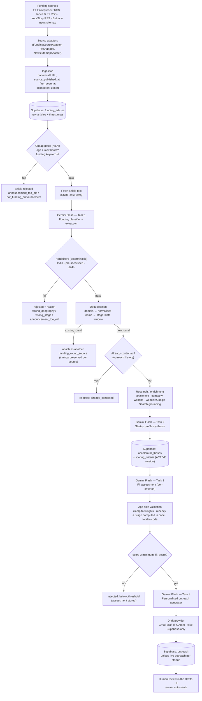

# Components Map

## End-to-end flow

## Frontend components (Next.js App Router, `src/app`)

| Route | Purpose | Key file |
|---|---|---|
| `/` | Dashboard: 24h stats, avg ingestion delay, pipeline status, "Run pipeline now" | `app/page.tsx`, `components/run-pipeline-button.tsx` |
| `/feed` | Funding events with every source report (published → first seen) + filtered-out articles | `app/feed/page.tsx` |
| `/qualified` | Qualified startups, score, top reasons, research + draft status | `app/qualified/page.tsx` |
| `/startups/[id]` | Profile, founders, rounds, source articles, research evidence, fit breakdown, outreach | `app/startups/[id]/page.tsx` |
| `/drafts` | Review/edit/approve/reject drafts; mark as sent manually | `app/drafts/page.tsx`, `actions.ts` |
| `/settings` | Thesis editor (versioned), weights (sum = 100), recency bands, stage points | `app/settings/page.tsx`, `components/thesis-form.tsx` |
| `/sources` | Source health + speed metrics (delay, wins, unique discoveries) | `app/sources/page.tsx` |
| `/login` | Operator sign-in (cookie = HMAC of `ADMIN_PASSWORD`) | `app/login/page.tsx`, `proxy.ts` |

## Backend components (`src/lib`)

| Module | Responsibility |
|---|---|
| `sources/` | `FundingSourceAdapter` interface, RSS + news-sitemap adapters, registry, article text extraction |
| `net/safe-fetch.ts` | SSRF-hardened fetch: http(s) only, public IPs only, manual redirect re-validation, timeout, size cap |
| `gemini/` | `AIService` interface, `GeminiService` (Gemini Flash), zod schemas, the four task prompts, response cache |
| `pipeline/` | `run.ts` orchestrator, `filters.ts` (hard filters), `prefilter.ts` (cheap relevance gate), event logger |
| `deduplication/` | Pure matching rules + `resolveStartupAndRound` over a repository interface (Supabase + in-memory impls) |
| `research/` | `ResearchProvider` implementations (articles, company website, Gemini+Google Search) and profile persistence |
| `scoring/` | `compute.ts` (pure scoring math), `config.ts` (loads active thesis), `assess.ts` (Gemini Task 3 + persistence) |
| `outreach/` | Outreach guard, generator (Gemini Task 4), `DraftProvider` (Gmail / database) |
| `thesis/` | zod schema shared by the settings UI and its server action |
| `supabase/admin.ts` | Server-only service-role client |
| API routes | `/api/cron/pipeline` (Bearer `CRON_SECRET`), `/api/pipeline/run` (admin cookie, runs in `after()`) |

## Third-party services

| Service | Use |
|---|---|
| Supabase (Postgres) | Single data store, versioned thesis, audit trail |
| Gemini Flash (Google AI) | **Every** runtime AI call (classification, profile synthesis, scoring, outreach; Google Search grounding for research) |
| Gmail API (optional) | `users.drafts.create` only — drafts, never sends |
| Vercel | Hosting + Cron |
| ET Entrepreneur, Inc42, YourStory, Entrackr | Public funding-news feeds |

## Data stores (Supabase tables)

`sources` · `funding_articles` · `startups` · `founders` · `funding_rounds` · `funding_round_sources` · `investors` · `funding_round_investors` · `accelerator_theses` · `scoring_criteria` · `fit_assessments` · `outreach` · `pipeline_runs` · `pipeline_events` · `ai_calls` (Gemini cache/audit). RLS is enabled everywhere with no policies; only the server's service-role key can access data.

## AI calls (all Gemini Flash, model id from `GEMINI_MODEL`)

| # | Task id | Input | Output |
|---|---|---|---|
| 1 | `classify_article` | headline, snippet, article text, source, published time | funding?, roundup?, company, India?, stage (normalised), amount, currency, investors, confidence |
| 2 | `synthesize_profile` (+ `research_grounded` with Google Search) | fetched documents + citations | structured profile with explicit `null`/`unknowns` |
| 3 | `assess_fit` | profile + active thesis + criteria to score | per-criterion scores, signals, concerns, reasoning, confidence (totals computed in code) |
| 4 | `generate_outreach` | profile, round, fit signals, sender | `{subject, body}` |

Structured calls use `responseMimeType: application/json` + `responseJsonSchema`, are validated with zod, get one repair retry, and are cached by input hash in `ai_calls`.

## Scheduling

`vercel.json` → Vercel Cron hits `GET /api/cron/pipeline` every 2 hours with `Authorization: Bearer $CRON_SECRET`. `.github/workflows/pipeline-cron.yml` is an optional equivalent for plans where Vercel Cron is limited to daily. Manual: dashboard button or `npm run pipeline`. A 15-minute run lock prevents overlapping runs; a time budget stops new work before the function limit and leaves the rest `pending` for the next run.

## Configuration

Business rules live in Supabase (`accelerator_theses`, `scoring_criteria`): allowed countries/stages, max age, threshold, sectors, weights, recency bands, stage points, thesis text. Secrets and runtime knobs live in environment variables (`.env.example`).
