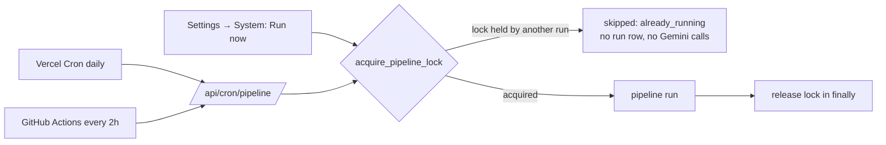
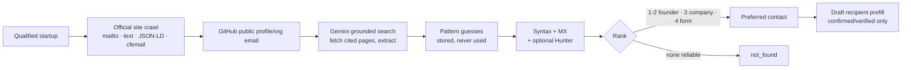

# Components Map

## End-to-end flow

## Frontend components (Next.js App Router, `src/app`)

The app is organised around the scout's tasks, not the pipeline: **Today · Opportunities · Drafts · Settings**. Technical detail is one or two interactions deeper (see `docs/ui-redesign-plan.md`, `docs/ui-redesign-audit.md`, `docs/ui-functionality-matrix.md`).

| Route | Purpose | Key files |
|---|---|---|
| `/` | Public landing page (product explainer, live headline numbers, link to the app) | `app/page.tsx` |
| `/today` | Morning briefing: what needs attention, drafts ready, one-line system health, priority opportunities | `app/(app)/today/page.tsx`, `components/opportunity/opportunity-card.tsx` |
| `/opportunities` | Work queue. **Active** = qualified startups ranked by fit then recency, status chips (All / New / Draft ready / Reviewed) and a Filters popover. **Discoveries** (`?view=discoveries`) = the broader funding feed; Relevant by default, rejected rounds and filtered articles under Filtered | `app/(app)/opportunities/page.tsx`, `lib/opportunity/*`, `components/opportunity/filter-popover.tsx` |
| `/opportunities/[id]` | Startup as a decision story: header, why now, why it fits (+ score breakdown), snapshot, product & traction, founders, outreach recommendation (+ contact details), then collapsed sources & evidence and technical details | `app/(app)/opportunities/[id]/page.tsx`, `components/startup/*` |
| `/drafts` | Review queue (To review / Approved / Done) | `app/(app)/drafts/page.tsx` |
| `/drafts/[id]` | Read the email, edit, approve, send (Resend, confirm dialog), Open in Gmail / copy, mark sent, reject, "Why this message" | `app/(app)/drafts/[id]/page.tsx`, `components/draft-review.tsx`, `draft-actions.tsx`, `send-draft-button.tsx`, `drafts/actions.ts` |
| `/settings` | **Investment Thesis**: six essentials; more preferences, advanced scoring and version history collapsed | `app/(app)/settings/page.tsx`, `components/thesis-form.tsx`, `stage-control.tsx` |
| `/settings/sources` | Sources as Healthy / Delayed / Issue / Paused; pause and resume; technical details and 14-day median ingestion delay inside each source | `app/(app)/settings/sources/page.tsx`, `lib/pipeline/source-health.ts` |
| `/settings/integrations` | Read-only status of research, email sending, Gmail drafts, schedulers | `app/(app)/settings/integrations/page.tsx` |
| `/settings/system` | Manual run, full 8-stage progress, recent runs, errors, event log, scheduler details | `app/(app)/settings/system/page.tsx`, `components/pipeline-progress.tsx` |
| `/api/system/health` | Feeds the always-on health indicator and the Drafts badge | `app/api/system/health/route.ts` |
| `/api/search` | ⌘K: startup, founder and sector search | `app/api/search/route.ts` |

Old links redirect (308, `next.config.ts`): `/dashboard → /today`, `/feed → /opportunities?view=discoveries`, `/qualified → /opportunities`, `/sources → /settings/sources`, `/settings/discovery → /settings/sources`, `/startups/:id → /opportunities/:id`.

**Shell and shared UI** (`src/components`): `shell/app-shell.tsx` (sidebar on desktop; top bar + bottom tab bar below 1024 px), `shell/shell-provider.tsx` (polled health snapshot; owns the health sheet and ⌘K dialogs), `shell/health-sheet.tsx`, `shell/search-command.tsx`, `ui.tsx` (button recipes, `PageHeader`, `Section`, `StatusChip`, tables), `disclosure-section.tsx` (native `
` progressive disclosure), `empty-state.tsx`, `loading-state.tsx`, `action-menu.tsx`, `confirm-dialog.tsx`. Design tokens (light/dark) live in `app/globals.css`.

**View-model logic** (pure, unit-tested): `lib/opportunity/model.ts` (ordering, "needs attention", fit tiers), `filters.ts` (URL-driven filters), `why.ts` (why now, why it fits, outreach angle, draft readiness and message checks — all derived from stored facts, never invented), `lib/labels.ts` (machine status → scout language), `lib/pipeline/health.ts` + `source-health.ts` (health sentences).

## Backend components (`src/lib`)

| Module | Responsibility |
|---|---|
| `sources/` | `FundingSourceAdapter` interface, RSS + news-sitemap adapters, registry, article text extraction |
| `net/safe-fetch.ts` | SSRF-hardened fetch: http(s) only, public IPs only, manual redirect re-validation, timeout, size cap |
| `gemini/` | `AIService` interface, `GeminiService` (Gemini Flash), zod schemas, the four task prompts, response cache |
| `pipeline/` | `run.ts` orchestrator, `filters.ts` (hard filters), `prefilter.ts` (cheap relevance gate), event logger |
| `deduplication/` | Pure matching rules + `resolveStartupAndRound` over a repository interface (Supabase + in-memory impls) |
| `research/` | `ResearchProvider` implementations (articles, company website, Gemini+Google Search) and profile persistence |
| `scoring/` | `compute.ts` (pure scoring math), `config.ts` (loads active thesis), `assess.ts` (Gemini Task 3 + persistence) |
| `outreach/` | Outreach guard, generator (Gemini Task 4), `DraftProvider` (Gmail / database) |
| `thesis/` | zod schema shared by the settings UI and its server action |
| `supabase/admin.ts` | Server-only service-role client |
| API routes | `/api/cron/pipeline` (Bearer `CRON_SECRET`), `/api/pipeline/run` (no login; runs in `after()`, serialized by the run lock) |

## Third-party services

| Service | Use |
|---|---|
| Supabase (Postgres) | Single data store, versioned thesis, audit trail |
| Gemini Flash (Google AI) | **Every** runtime AI call (classification, profile synthesis, scoring, outreach; Google Search grounding for research) |
| Gmail API (optional) | `users.drafts.create` only — drafts, never sends |
| Vercel | Hosting + Cron |
| ET Entrepreneur, ET Startups, Inc42, YourStory, Entrackr | Public funding-news feeds |

## Data stores (Supabase tables)

`sources` · `funding_articles` · `startups` · `founders` · `funding_rounds` · `funding_round_sources` · `investors` · `funding_round_investors` · `accelerator_theses` · `scoring_criteria` · `fit_assessments` · `outreach` · `pipeline_runs` · `pipeline_events` · `ai_calls` (Gemini cache/audit). RLS is enabled everywhere with no policies; only the server's service-role key can access data.

## AI calls (all Gemini Flash, model id from `GEMINI_MODEL`)

| # | Task id | Input | Output |
|---|---|---|---|
| 1 | `classify_article` | headline, snippet, article text, source, published time | funding?, roundup?, company, India?, stage (normalised), amount, currency, investors, confidence |
| 2 | `synthesize_profile` (+ `research_grounded` with Google Search) | fetched documents + citations | structured profile with explicit `null`/`unknowns` |
| 3 | `assess_fit` | profile + active thesis + criteria to score | per-criterion scores, signals, concerns, reasoning, confidence (totals computed in code) |
| 4 | `generate_outreach` | profile, round, fit signals, sender | `{subject, body}` |

Structured calls use `responseMimeType: application/json` + `responseJsonSchema`, are validated with zod, get one repair retry, and are cached by input hash in `ai_calls`.

## Scheduling

The app deliberately runs on the **Vercel Hobby (free) plan**, where Vercel Cron can fire at most once a day. Two schedulers therefore call the *same* secured endpoint, `GET /api/cron/pipeline` (`Authorization: Bearer $CRON_SECRET`):

| Scheduler | Cadence | Role |
|---|---|---|
| Vercel Cron (`vercel.json`) | daily, 03:30 UTC (09:00 IST) | Morning safety/anchor run; works even if GitHub is unavailable |
| GitHub Actions (`.github/workflows/pipeline-cron.yml`) | every 2 hours (minute 15) | The discovery cadence the product needs |

GitHub scheduled workflows have no timing guarantee and can start late (or occasionally skip a slot), so the one-line system health indicator (and its details sheet) shows the time since the last successful run and flags *Delayed* / *Discovery issue*. The pipeline can always be run manually from Settings → System (or `npm run pipeline`).

**Concurrency control.** Runs are serialized by an atomic lease in Postgres (`pipeline_lock` table, `acquire_pipeline_lock` / `release_pipeline_lock` functions, migration `20261012000005`). A single `INSERT … ON CONFLICT DO UPDATE … WHERE expires_at <= now()` claims the lease, so two simultaneous triggers cannot both win. (A session-level `pg_advisory_lock` was rejected because the app talks to Postgres over stateless HTTP, where the lock's connection is not stable.) The lease is sized to the run deadline plus a grace period, is released in a `finally`, and expires on its own if a function instance dies. When a new run takes the lock, any `pipeline_runs` row still `running` is marked `failed` with a `stale_run` error. A caller that loses the race gets `{"status":"skipped","reason":"already_running"}` (HTTP 200) before any source is polled or Gemini is called. Row-level unique indexes (articles, startups, rounds, one live outreach per startup) remain as a second line of defence.

A time budget stops new work before the function limit and leaves the rest `pending` for the next run.

## Configuration

Business rules live in Supabase (`accelerator_theses`, `scoring_criteria`): allowed countries/stages, max age, threshold, sectors, weights, recency bands, stage points, thesis text. Secrets and runtime knobs live in environment variables (`.env.example`).

## UI shell and theming

Public landing page at `/` (`src/app/page.tsx`); the operator pages live in the `(app)` route group, whose layout adds the navigation bar. Light/dark mode is a class on `<html>` set before paint by an inline script (saved choice, else the OS preference) and switched by `components/theme-toggle.tsx`; `globals.css` remaps the Tailwind palette variables under `.dark`.

**Access.** There is no login: anyone with the URL can view the pages, edit the thesis, review drafts and trigger a run. `/api/cron/pipeline` still requires `CRON_SECRET`. The run lock prevents overlapping runs, but see the README for the exposure this implies.

## Contact discovery (`src/lib/contacts`)

Runs after a startup qualifies and before the draft is created (`pipeline/run.ts` → `enrichContactsSafely`, plus a per-run backfill). Free sources only.

| Module | Role |
|---|---|
| `crawler.ts`, `robots.ts`, `http.ts` | Polite same-domain crawl, robots.txt, retries with jittered backoff, per-host rate limit; all fetches go through `net/safe-fetch.ts` (SSRF guard on every redirect) |
| `extract.ts`, `attribute.ts`, `names.ts` | Email extraction and founder/company attribution |
| `github.ts`, `search.ts`, `patterns.ts` | Discovery providers |
| `verify.ts` | Syntax, MX (null-MX aware), optional Hunter verification |
| `rank.ts` | Preferred-contact hierarchy and non-downgrading merge |
| `pipeline.ts` | Orchestration (`enrichStartupContacts`, `enrichMany`); store/provider interfaces for testing |
| `storage.ts`, `budget.ts` | Supabase persistence (idempotent upserts), monthly free-quota budget |

Tables: `startup_contacts` (one row per address / contact form; one preferred per startup), `enrichment_budget`; columns `startups.contact_status/contact_checked_at/contact_error`.

## Run progress (`pipeline/progress.ts`)

`ProgressTracker` keeps a done/total counter per stage (`sources → prefilter → classify → filters → research → scoring → contacts → drafts`) plus a one-line activity message, and writes it (throttled) to `pipeline_runs.progress_json`. `run.ts` feeds it as items pass through each stage (`add` / `tick` / `track`). The Settings → System component `components/pipeline-progress.tsx` (and the friendlier five-phase `components/scan-status.tsx`) poll `GET /api/pipeline/progress`. If the column is missing the writer fails once and progress is switched off without affecting the run.

## Sending (`outreach/send.ts`, `send-store.ts`)

`sendApprovedDraft` is called only by the `sendDraftEmail` server action behind the Send button on the Drafts page (`components/send-draft-button.tsx`). It checks configuration, draft status, recipient validity and contact verification, then POSTs to Resend with an idempotency key, marks the draft `sent` and logs the Resend id. The store/fetch are injected so the rules are unit-tested without the network.
